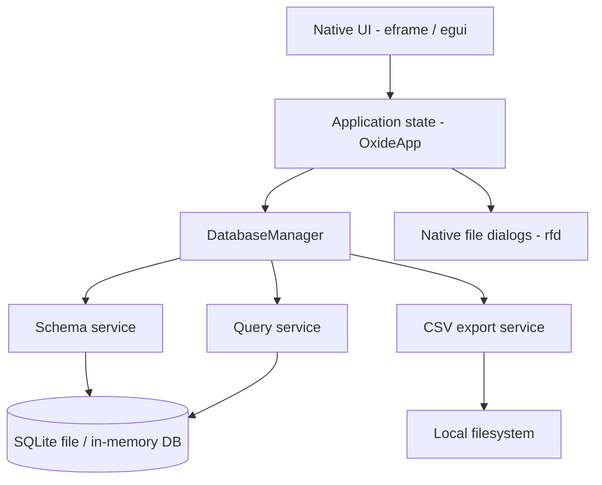
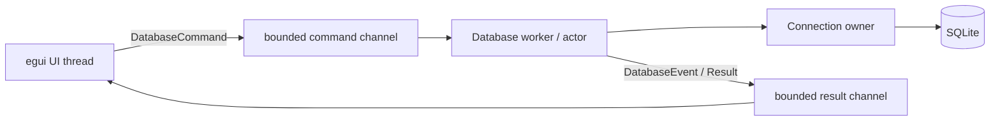

# Architecture

## 1. Product principles

1. **Local first:** database files stay on the user's machine; no account or network service is required.
2. **Rust owns the critical path:** database I/O, query execution, data conversion, and application state live in Rust.
3. **Bounded by default:** table browsing and query output have explicit limits; the UI does not eagerly materialize an entire database.
4. **Explicitly destructive:** SQL is never silently rewritten. The user runs the statement they entered.
5. **Progressive capability:** the prototype keeps the first useful workflow small while the architecture leaves seams for import/export, editing, diagnostics, and plugins.

## 2. Logical architecture

### Current runtime flow

1. `main.rs` initializes tracing, configures the native viewport, and starts `eframe`.
2. `OxideApp` owns the UI session state: active workspace, selected schema object, current page, query editor, output, and history.
3. `DatabaseManager` owns at most one `rusqlite::Connection` and records the active path/read-only mode.
4. Schema and query modules execute bounded, parameterized metadata or data-access operations against that connection.
5. Results are converted to display strings at the database boundary; BLOB values are represented by a size marker rather than materialized as a UI string.
6. The CSV module writes the current query result using a CSV writer, so commas, quotes, and line breaks are escaped correctly.

## 3. Module responsibilities

| Module | Responsibility | Must not do |
|---|---|---|
| `app` | UI state, orchestration, dialogs, user feedback | Construct raw SQL from untrusted values except quoted identifiers in the schema layer |
| `db::connection` | Connection lifecycle, open flags, PRAGMA setup | Render UI or decide presentation |
| `db::schema` | Enumerate schema objects, inspect columns, read table pages, quote identifiers | Execute arbitrary user SQL |
| `db::query` | Prepare and execute one user-provided statement; cap result rows | Persist query history or render results |
| `db::value` | Convert SQLite values to safe display strings | Retain large BLOB payloads |
| `db::export` | Write query output as CSV | Open UI dialogs |
| `ui::theme` | Define visual tokens and widget styling | Own database state |

## 4. State and ownership

`DatabaseManager` is the single owner of the SQLite connection. The prototype uses one connection and performs operations on the UI thread. This is intentionally simple for the first executable slice, but it has a known responsiveness trade-off: a long-running query can block input and repaint.

### Production target: database actor

Before adding import jobs, large table edits, or query cancellation, move connection ownership to a dedicated worker thread:

Design constraints for that change:

- The worker owns the connection; the UI never receives `Connection` or `Statement` values.
- Commands carry an operation id so stale results can be ignored after switching databases.
- Use bounded channels and back-pressure rather than accumulating unbounded query output.
- Query row limits and byte limits are separate. A single row can contain a large text value.
- Cancellation is cooperative where SQLite permits it (`sqlite3_interrupt` / progress handler); it must not imply rollback unless a transaction is explicitly managed.
- All writes must use explicit transaction boundaries and report commit/rollback outcomes.

## 5. Database access design

- `rusqlite` is compiled with `bundled`, which builds SQLite from source and avoids dependence on a system SQLite version.
- File connections are opened with `SQLITE_OPEN_READ_ONLY` or `SQLITE_OPEN_READ_WRITE | SQLITE_OPEN_CREATE`.
- A 5-second SQLite busy timeout is configured.
- Foreign-key enforcement is enabled for the connection.
- Writable file connections request WAL mode; failure to switch journal mode does not prevent opening the database.
- Table identifiers are quoted by doubling embedded double quotes. User-entered SQL is passed to SQLite as-is and is not concatenated with application-generated values.
- The SQL workbench prepares one statement per run. Bind parameters are not yet exposed in the UI.
- Query results are capped at 1,000 rows, text display is capped at 16,384 characters per cell, and table browsing fetches 200 rows at a time using `LIMIT` and `OFFSET`. A shared aggregate result-memory budget remains a production requirement.

## 6. Data model at the UI boundary

The current display contract is deliberately small:

- Column labels are owned `String` values.
- Each result row is a vector of display strings.
- SQL `NULL` is rendered as `NULL` in a muted style.
- BLOBs are summarized as `[BLOB · N bytes]` to avoid dumping binary bytes into the UI.
- The query result stores elapsed time, optional affected-row count, and whether the row cap was reached.

A production data grid should replace string-only values with a typed `CellValue` enum so sorting, editing, filtering, and export do not need to parse formatted strings.

## 7. Performance strategy

### Implemented in prototype

- Native UI and native SQLite library; no local HTTP stack.
- Single connection, no background polling.
- Lazy schema enumeration on open/refresh.
- 200-row table pages and 1,000-row query cap.
- BLOB payloads are not copied into display strings.
- Release profile uses thin LTO, one codegen unit, and binary stripping.

### Production requirements

- Worker-thread database actor and cancellable queries.
- Virtualized table grid; do not construct all visible cell widgets for an entire large result.
- Column width sampling, row-height caching, and lazy BLOB preview.
- Query memory budget measured in bytes as well as rows.
- Query plan visualization and slow-query thresholds.
- Benchmarks for 10k/100k/1m row data sets, wide rows, and large BLOB columns.

## 8. Error handling and observability

- Database and filesystem errors are returned with `anyhow::Context` at the boundary.
- The UI shows the error message in its status region and logs it through `tracing`.
- Production should introduce a stable error taxonomy (`Open`, `Read`, `Write`, `SqlSyntax`, `Constraint`, `Busy`, `Cancelled`, `Export`, `Unsupported`) for localization and actionable recovery guidance.
- Never log SQL bind values, database contents, or file contents by default.

## 9. Extension seams

The following boundaries should be preserved when the application grows:

- `DatabaseProvider` trait for SQLite connection/session operations.
- `ImportSource` and `ExportSink` traits for CSV/JSON/SQL/Parquet adapters.
- `MigrationProvider` for schema versioning and change preview.
- `PluginHost` only after a permission and capability model has been designed; never load arbitrary native code by default.
- `WorkspaceRepository` for sessions, query tabs, saved snippets, and recent files.
