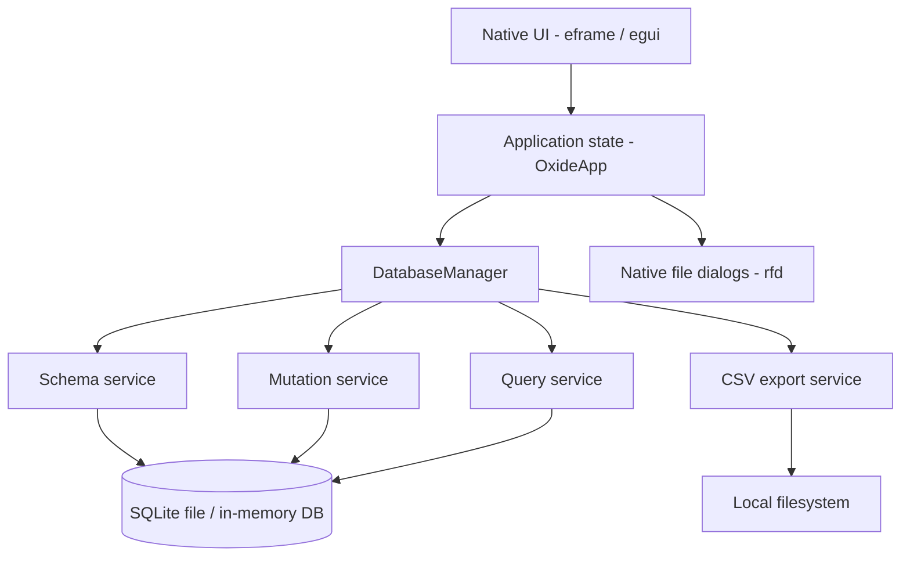
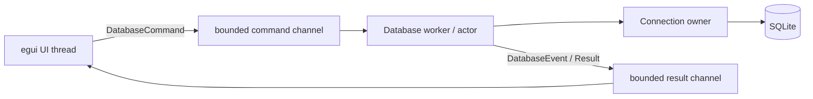
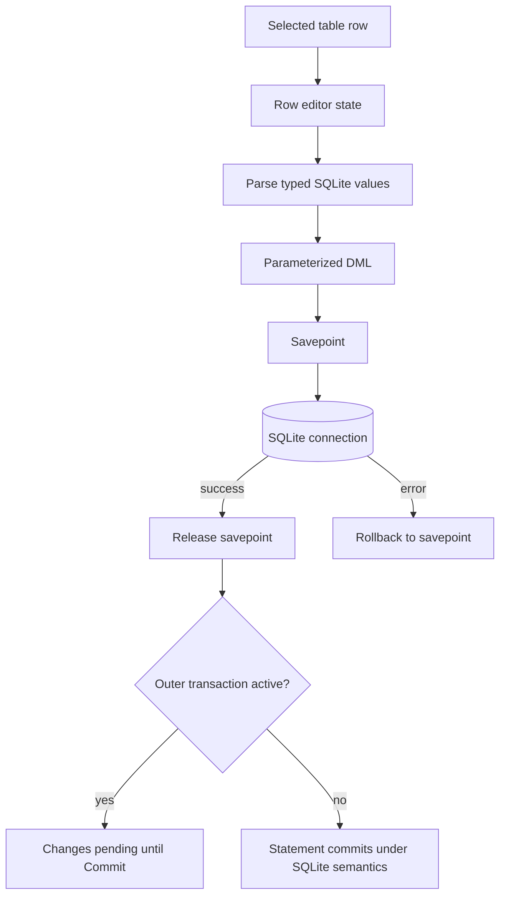

# Architecture

## 1. Product principles

1. **Local first:** database files stay on the user's machine; no account or network service is required.
2. **Rust owns the critical path:** database I/O, query execution, data conversion, and application state live in Rust.
3. **Bounded by default:** table browsing and query output have explicit limits; the UI does not eagerly materialize an entire database.
4. **Explicitly destructive:** SQL is never silently rewritten. The user runs the statement they entered.
5. **Progressive capability:** the 0.2 release delivers guided row editing and a bounded schema/transaction workflow while leaving heavier import/export, diagnostics, and plugins for later milestones.

## 2. Logical architecture

### Current runtime flow

1. `main.rs` initializes tracing, configures the native viewport, and starts `eframe`.
2. `OxideApp` owns the UI session state: active workspace, selected schema object, current page, query editor, output, and history.
3. `DatabaseManager` owns at most one `rusqlite::Connection` and records the active path/read-only mode.
4. Schema and query modules execute bounded, parameterized metadata or data-access operations against that connection.
5. Table pages retain owned SQLite storage-class values alongside bounded display strings. BLOB values are shown as a size marker in the grid while the editor retains the bytes for unchanged-field updates.
6. Guided INSERT/UPDATE/DELETE and supported schema operations run through a parameterized mutation layer with per-operation savepoints. Explicit transactions are connection-scoped.
7. The CSV module writes the current query result using a CSV writer, so commas, quotes, and line breaks are escaped correctly.

## 3. Module responsibilities

| Module | Responsibility | Must not do |
|---|---|---|
| `app` | UI state, orchestration, dialogs, user feedback | Construct raw SQL from untrusted values except quoted identifiers in the schema layer |
| `db::connection` | Connection lifecycle, open flags, PRAGMA setup | Render UI or decide presentation |
| `db::schema` | Enumerate schema objects, inspect `table_xinfo`, read typed table pages, derive row identities, quote identifiers | Execute arbitrary user SQL |
| `db::mutations` | Build parameterized row mutations and bounded schema DDL; wrap guided writes in savepoints | Render UI or interpret arbitrary Workbench scripts |
| `db::query` | Prepare and execute one user-provided statement; cap result rows | Persist query history or render results |
| `db::value` | Convert SQLite values to safe display strings | Retain large BLOB payloads |
| `db::export` | Write query output as CSV | Open UI dialogs |
| `ui::theme` | Define visual tokens and widget styling | Own database state |

## 4. State and ownership

`DatabaseManager` is the single owner of the SQLite connection. The prototype uses one connection and performs operations on the UI thread. This is intentionally simple for the first executable slice, but it has a known responsiveness trade-off: a long-running query can block input and repaint.

### Production target: database actor

Before adding import jobs, large table edits, or query cancellation, move connection ownership to a dedicated worker thread:

Design constraints for that change:

- The worker owns the connection; the UI never receives `Connection` or `Statement` values.
- Commands carry an operation id so stale results can be ignored after switching databases.
- Use bounded channels and back-pressure rather than accumulating unbounded query output.
- Query row limits and byte limits are separate. A single row can contain a large text value.
- Cancellation is cooperative where SQLite permits it (`sqlite3_interrupt` / progress handler); it must not imply rollback unless a transaction is explicitly managed.
- All writes must use explicit transaction boundaries and report commit/rollback outcomes.

## 5. Database access design

- `rusqlite` is compiled with `bundled`, which builds SQLite from source and avoids dependence on a system SQLite version.
- File connections are opened with `SQLITE_OPEN_READ_ONLY` or `SQLITE_OPEN_READ_WRITE | SQLITE_OPEN_CREATE`.
- A 5-second SQLite busy timeout is configured.
- Foreign-key enforcement is enabled for the connection.
- Writable file connections request WAL mode; failure to switch journal mode does not prevent opening the database.
- Table and column identifiers in guided operations are quoted by doubling embedded double quotes. Cell values are bound as SQLite parameters and are never interpolated into DML.
- Guided schema declarations use a strict type-name grammar; default values are emitted as escaped SQLite literals. The exposed DDL subset is intentionally smaller than SQLite's full grammar.
- The SQL workbench prepares one statement per run. Bind parameters are not yet exposed in the UI, and raw SQL bypasses guided destructive confirmations.
- Query results are capped at 1,000 rows, text display is capped at 16,384 characters per cell, and table browsing fetches 200 rows at a time using `LIMIT` and `OFFSET`. Typed table pages retain full raw values for that page, so unusually large BLOB/TEXT data can still consume memory.

## 6. Data model at the UI boundary

The 0.2 table-grid boundary contains both display and typed data:

- Column labels are owned `String` values; each visible row has a display-string row and a parallel raw `rusqlite::types::Value` row.
- SQL `NULL` is rendered as `NULL` in a muted style and remains `Value::Null` in the editor.
- BLOBs are summarized as `[BLOB · N bytes]` in the grid, while the full byte vector is retained for unchanged-field updates and can be edited using a `hex:` form.
- Row identities are declared primary-key tuples where available, otherwise an unshadowed hidden rowid alias on ordinary rowid tables. Views and unsupported identity cases remain browse-only for update/delete.
- Generated columns are loaded for display but the row editor marks them read-only.
- The SQL query result still stores display strings, elapsed time, optional affected-row count, and whether the row cap was reached.

## 7. Performance strategy

### Implemented in 0.2.0

- Native UI and native SQLite library; no local HTTP stack.
- Single connection, no background polling.
- Lazy schema enumeration on open/refresh.
- 200-row table pages and 1,000-row query cap.
- BLOB payloads are not copied into display strings, but the current 200-row editing page owns raw values for writes.
- Release profile uses thin LTO, one codegen unit, and binary stripping.

### Production requirements

- Worker-thread database actor and cancellable queries.
- Virtualized table grid; do not construct all visible cell widgets for an entire large result.
- Column width sampling, row-height caching, and lazy BLOB preview.
- Query memory budget measured in bytes as well as rows.
- Query plan visualization and slow-query thresholds.
- Benchmarks for 10k/100k/1m row data sets, wide rows, and large BLOB columns.

## 8. Error handling and observability

- Database and filesystem errors are returned with `anyhow::Context` at the boundary.
- The UI shows the error message in its status region and logs it through `tracing`.
- Production should introduce a stable error taxonomy (`Open`, `Read`, `Write`, `SqlSyntax`, `Constraint`, `Busy`, `Cancelled`, `Export`, `Unsupported`) for localization and actionable recovery guidance.
- Never log SQL bind values, database contents, or file contents by default.

## 9. Extension seams

The following boundaries should be preserved when the application grows:

- `DatabaseProvider` trait for SQLite connection/session operations.
- `ImportSource` and `ExportSink` traits for CSV/JSON/SQL/Parquet adapters.
- `MigrationProvider` for schema versioning and change preview.
- `PluginHost` only after a permission and capability model has been designed; never load arbitrary native code by default.
- `WorkspaceRepository` for sessions, query tabs, saved snippets, and recent files.

## 10. 0.2.0 editing and transaction architecture

The v0.2.0 data path retains typed SQLite values alongside display strings. `TableData` now carries:

- `columns`: visible column names.
- `rows`: bounded display strings for the egui table grid.
- `raw_rows`: owned `rusqlite::types::Value` values used by guided editors. Display text is never used as the source for a write.
- `row_identities`: a key for each row when a safe identity is available; `None` marks browse-only rows.

`db::schema` prefers declared primary-key columns, sorted by SQLite's primary-key ordinal. If no primary key exists on an ordinary rowid table, it selects an unshadowed hidden alias from `rowid`, `_rowid_`, and `oid`. Virtual tables, views, and tables where no safe identity can be found are browse-only for update/delete.

`db::mutations` owns generated DML/DDL. It quotes identifiers, binds cell values, checks affected-row counts, and wraps each guided mutation in the `oxide_studio_mutation` savepoint. The savepoint nests inside an optional explicit user transaction; releasing it does not commit the outer transaction. Errors attempt rollback to and release of the savepoint before returning to the UI.

`DatabaseManager` owns transaction state through the SQLite connection itself. `is_in_transaction` queries `Connection::is_autocommit()` rather than storing a duplicate boolean. The transaction API issues `BEGIN DEFERRED`, `BEGIN IMMEDIATE`, or `BEGIN EXCLUSIVE`, then explicit `COMMIT` / `ROLLBACK`. This also reflects transaction statements run from the SQL Workbench.

The UI layer owns only editor state and confirmation state. It converts user-entered text to typed SQLite values based on declared type affinity; SQLite constraints remain authoritative. Guided delete/drop/rollback actions use typed confirmation tokens. The SQL Workbench is deliberately direct and does not use the guided confirmation layer.

### Write path

### Schema operation boundary

The UI exposes SQLite's supported create/rename/add/drop subset. `ADD COLUMN` defaults are literals only. Arbitrary table rebuilds are intentionally deferred because a correct rebuild must preserve or deliberately migrate indexes, triggers, generated columns, CHECK/UNIQUE constraints, collations, foreign keys, AUTOINCREMENT state, and dependent schema objects. A future schema migration workflow must provide a diff/preview and a verified rollback path before advertising generic column alteration.

### Explicit transaction lifecycle

The connection, not UI state, is the source of truth for autocommit state. Switching database connections is blocked while a transaction is active. A connection drop will cause SQLite to roll back pending changes, but the user is guided to finish transactions explicitly. Guided mutations nest savepoints inside the current transaction so an individual failed form submission need not abort all earlier work in that transaction.

## 11. 0.2.0 runtime limits

- UI and SQLite operations remain synchronous on the UI thread.
- Table pages are still `LIMIT/OFFSET` bounded; large offsets may become expensive.
- The data editor materializes one 200-row page and owned raw values for it. There is not yet an aggregate byte budget for unusually large TEXT/BLOB values.
- Hidden rowid identities are less durable than declared primary keys. A future hardened grid should also consider external concurrent changes and schema refresh invalidation.
- There is no undo stack beyond uncommitted SQLite transaction rollback.
